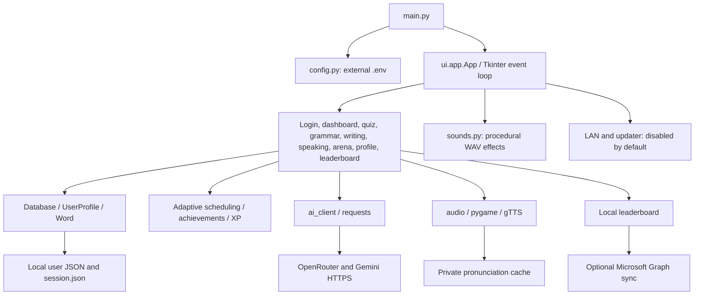

# HanziFlow architecture

HanziFlow is a discontinued Python/Tkinter desktop prototype. This document describes the current source rather than a proposed web rewrite. Known bugs and incomplete features remain.

## Runtime and data flow

`main.py` selects the application directory, loads allowed external configuration, configures UTF-8 logging, and launches `ui.app.App`. `App` owns the Tkinter root and swaps views. Background work uses daemon threads; portions of UI completion are scheduled through Tkinter callbacks and `after`. All callbacks have not been reviewed for thread safety.

## Responsibilities

| Module | Responsibility |
| --- | --- |
| `config.py` | Application directory, configuration allowlist, username validation |
| `core/models.py` | Vocabulary, profiles, statistics, ranks, password hashing |
| `core/database.py` | Singleton JSON profile store, account index, remembered session |
| `core/adaptive.py` | SM-2 scheduling, sampling, weakness tracking, levels, arena points |
| `core/achievements.py`, `xp_config.py` | Achievement checks and rewards |
| `core/ai_client.py` | OpenRouter text/images, Gemini TTS/speech, rate limiting and in-memory responses |
| `core/audio.py` | Pronunciation playback, gTTS fallback, per-user WAV cache |
| `core/sounds.py` | Nine generated sound effects, independent of the pronunciation cache |
| `core/lan_server.py`, `core/notifications.py` | Experimental discovery/chat, friends, local notifications and outbox |
| `core/leaderboard.py` | Local ranking and optional OneDrive sync |
| `core/updater.py` | Explicitly enabled release check and executable replacement |
| `ui/app.py` | Main window, navigation, profile lifecycle, integration setup |
| `ui/theme.py`, `ui/widgets.py`, `ui/widgets_calendar.py` | Theme, controls, calendar, overlays |
| `ui/views/` | Individual learning and account screens |
| `ui/friends_panel.py`, `ui/notif_bell.py`, `ui/streak_overlay.py`, `ui/update_dialog.py` | Auxiliary UI panels |

## Persistence and account boundaries

`users/_index.json` maps account names to password hashes. `users/<username>.json` stores email, vocabulary, mistakes, rewards, and preferences. Friends, messages, queued events, notifications, writing cache, and panel position use separate files with the same username prefix. Filename validation rejects path separators, reserved device names, and internal-name collisions. Registration rejects case-only duplicates on Windows.

New passwords use PBKDF2-HMAC-SHA256 with 600,000 iterations and a random 16-byte salt. Legacy SHA-256 records are accepted for compatibility and migrated after successful password verification. The previous real accounts were removed from this source tree.

`session.json` remembers a username rather than holding a server-issued token. Profiles and messages are not encrypted at rest. Account separation is a local convenience, not a security boundary against another OS process or filesystem user. JSON files are not a transactional database; concurrent application instances are not guaranteed to be safe.

## External services and trust boundaries

AI actions can send text, images, audio, and selected learning statistics to OpenRouter or Gemini. OpenRouter authentication uses an Authorization header; Gemini uses `x-goog-api-key`. The modified API paths do not log key values, HTTP error response bodies, or raw generated content. gTTS can send pronunciation text to an external service without a Gemini key. Microsoft Graph sync uses a separately supplied token.

The default configuration does not start LAN listeners or broadcasts. Opting in opens UDP 55777 for discovery and TCP 55778 for chat. Legacy XOR derives its key from public usernames and cannot provide confidentiality or authenticate peers. Added connection timeouts and name validation do not repair that protocol.

Updates are disabled by default and have no hardcoded personal repository. Opting in requires a GitHub `owner/repository`; the initial executable URL must match that repository's configured release asset. Release signatures and HTTP redirect destinations are not independently verified. Manual review and installation remain necessary for a trustworthy release workflow.

Local changelog metadata is used when updates are disabled, so the changelog screen does not require a personal GitHub account.

## Distribution

`build_exe.py`, `HanziFlow.spec`, and `main.spec` include public metadata and the license. They do not bundle external `.env` files or runtime user data. Frozen applications load configuration and save data beside the executable, which can be unsuitable for protected installation directories; an OS app-data migration remains future work.

The local `.venv` is a development/runtime environment and is excluded from source publication. Temporary regression-test directories are also excluded. There is no website source, backend, or deployment configuration in this repository.

The application's live UI, hardware audio, multiplayer, and rebuilt executable have not been verified as part of this source cleanup.
